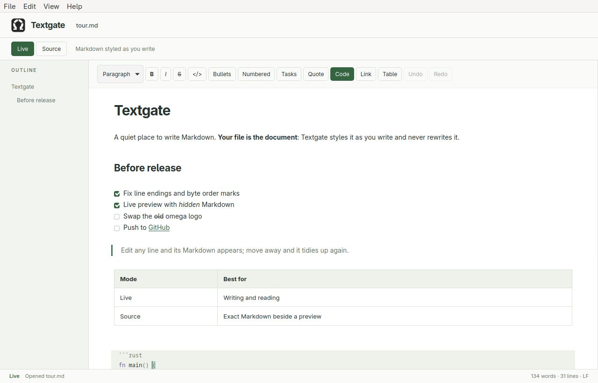
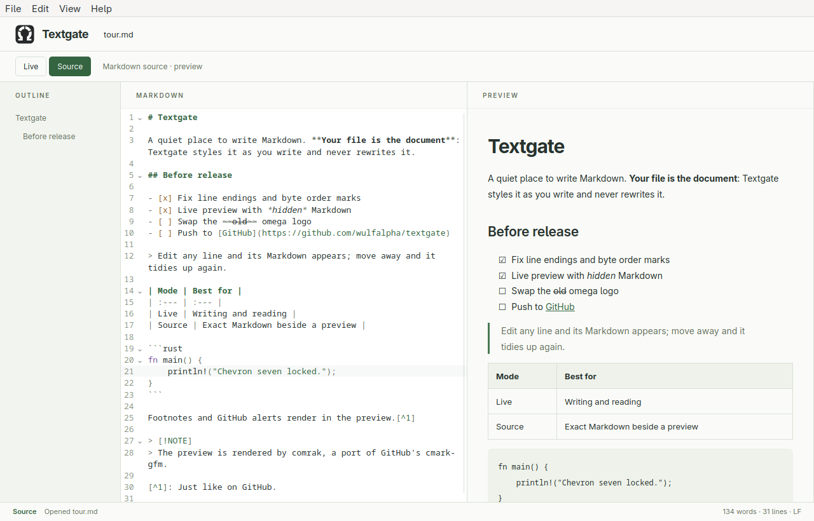

# Textgate

A lightweight desktop Markdown editor built with Rust, Tauri 2, CodeMirror 6, and comrak.

**Status: early release.** v0.2.0 adds ID-named notes, confirmed creation from
missing links, backlinks, reviewed rename link updates and quick note search.
It also includes crash recovery, restored tabs, outside-change detection and
local images. Packages target Linux, Windows and macOS (Apple Silicon and Intel).
Download [v0.2.0](https://github.com/wulfalpha/textgate/releases/tag/v0.2.0).
See the [0.2.0 release notes](docs/releases/0.2.0.md),
[release checklist](docs/release-checklist.md),
[package testing guide](docs/testing-0.1.4.md) and
[contributor guide](CONTRIBUTING.md).



The [Textgate logo](docs/branding/README.md) combines a segmented omega
with code-bracket feet, with a vector master and desktop icon exports.

**Your Markdown file is the document.** Textgate never re-serializes it: the only
changes saved are the ones you type, formatting commands you run, or link updates
you explicitly approve in a rename preview. These touch only the affected markup.
Opening and saving an unedited UTF-8
file preserves its bytes, including mixed LF, CRLF and CR line endings, a UTF-8
byte order mark, whitespace, and the presence or absence of a final newline.
Existing line breaks retain their spelling during edits; newly inserted breaks
use the file's most frequent style (LF for new documents; ties prefer CRLF, then
LF, then CR). Undo and redo restore line endings along with text.

To standardize a file deliberately, choose **Edit → Normalize line endings…**,
select LF, CRLF or CR, then save. Normalization is undoable and marks the document
as changed without rewriting its Markdown text. If an edit brings a CR directly
next to an LF, Textgate spells the second break as CRLF so two logical line breaks
do not collapse into one when the file is reopened. Files that are not valid UTF-8 are
refused rather than opened lossily. The app uses vanilla JavaScript and CSS with
Vite; no UI framework is required.

> **Windows status.** The 0.1.7 Windows package was tested by hand: it
> installs and launches, and links and local images work. For 0.1.6, Windows
> MSI testing confirmed tab switching, close and quit
> dialogs, file creation/rename/trash, and CLI/Explorer multi-file opening.
> Ctrl+S, Ctrl+Shift+S and Ctrl+W also passed with the expected prompts in the
> rebuilt MSI. Explorer Open With required adding Textgate manually.
> Spell checking does not work on Windows yet (see
> [Spell checking](#spell-checking)). Windows support may trail Linux and macOS
> for now; reports are welcome.

## Quick note search

Choose **File → Quick Note Search…** or press **Ctrl/Cmd+P** to find notes in
the open folder by filename or timestamp ID. Matching ignores case; words can
also match folder names. Results show relative paths. Use ↑/↓ and Enter, or click
a result, to open it. Escape cancels. Already-open notes keep their existing tab,
unsaved text and undo history. Refresh reconciles outside changes; results also
refresh while the search stays open. Scan limits are marked as partial results.
This searches names and IDs, not note contents.

## Tabs

Each open document has its own tab, with its own undo history, cursor and scroll
position. Live/Source mode, Vim, line numbers and spell checking apply to every
tab. **New** opens an empty tab, and **Open** accepts several files at once. A
file that is already open, even through a symbolic link or linked folder, is
shown in its existing tab rather than opened twice. Opening a file while the
current tab is a blank Untitled one (including the welcome text) replaces it.

Close a tab with **File → Close Tab** (Ctrl/Cmd+W), its × button, a middle-click,
or Delete while the tab has keyboard focus. A tab with unsaved changes asks
**Save / Don't Save / Cancel**; if the save is cancelled or fails, the tab stays
open. Closing the last tab leaves an empty Untitled one. Quitting lists every
tab with unsaved changes. Save As onto a file that is open in another tab is
refused; close that tab first.

Tabs with the same file name show their folder (`notes.md — work`), and hovering
a tab shows its full path. The tab bar is a keyboard tab list: arrow keys, Home
and End move between tabs, and Enter or Escape returns to the editor. Tabs are
not restored after a restart yet.

## File browser

**File → Open Folder…** makes one folder the workspace, and the sidebar's
**Files** view lists its folders, Markdown files (`.md`, `.markdown`) and text
files (`.txt`). Hidden entries (starting with `.`, such as `.git`),
`node_modules` and other files are left out; folders come first, then files, in
natural order (`note 2` before `note 10`). A folder with more than 1,000 entries
shows the first 1,000. `textgate ~/notes` opens a folder the same way. The
workspace, and the folders left open in it, are reopened at the next launch;
**File → Close Folder** closes it, and open tabs stay open.

Click a file to open it in a tab with focus left in the list (so F2 and
Delete or Cmd+Backspace act on it), or press Enter to open it and move into it.
The current tab's file is highlighted and its folders open to show it; files
open in other tabs are
marked, and unsaved ones show a dot. The list refreshes when the window regains
focus, after Textgate's own changes, and with the ↻ button.

Right-click (or press the menu key or Shift+F10) for:

- **New File…** and **New Folder…**, inside the folder clicked (or the clicked
  file's folder). New files get `.md` unless named `.md`, `.markdown` or `.txt`,
  are created empty and open in a tab. The **New File** and **New Folder**
  buttons use the selected folder.
- **Rename…** (F2). A file keeps its extension unless a Markdown or text one is
  typed. Open tabs follow the rename, including files inside a renamed folder.
  Note renames preview affected links and offer **Rename and Update Links**,
  **Rename Only**, or **Cancel**. Updated open notes stay unsaved and support
  undo; closed notes are written after conflict checks. Folder renames do not
  update links. Existing note ID prefixes must be retained.
- **Move to Trash…** (Delete, or Cmd+Backspace on macOS), after asking. Items go
  to the system trash, never deleted outright; a trashed file's open tab keeps
  its text, and saving it recreates the file.
- **Show in File Manager** and **Refresh**.

Nothing is ever replaced: creating or renaming onto an existing name is refused.
Names must be valid on every platform (no `/ \ : * ? " < > |`, no leading or
trailing dot). Choose **Files**, **Outline**, or **Backlinks** at the top of the sidebar or in
the View menu; **View → Sidebar** shows or hides it. Drag the sidebar's edge to
resize it (or focus the edge and use the arrow keys; double-click resets it).
Textgate watches visible folders and open files: clean tabs reload
outside edits, while unsaved tabs keep their text and show a warning. Deleted
files keep their tab contents; Save asks before recreating them. **Reload from
disk…** asks before discarding editor changes. Reload starts a fresh undo
history, preserves line-ending metadata and keeps the primary cursor/selection.
Focus and periodic checks cover missed notifications. See the
[file-watching milestone](docs/plans/0.1.7-file-watching.md) for limits.

## Saving documents

Saves write and flush a temporary file in the document's directory before
replacing the original. Existing file permissions are preserved. Before saving,
Textgate compares the disk bytes with the version last opened or saved. If the
file changed or disappeared, you can cancel or explicitly overwrite/recreate it.
Cancel keeps your edits in the editor; Save As lets you keep a separate copy.
If you try another menu file action or close the window while an operation is
running, the status bar asks you to finish or cancel that operation and try again.
Closing is not queued. Incoming command-line/file-manager opens queue until the
current operation finishes, then open in their own tabs.

This detects external changes but does not lock out other editors during the
final replacement. Directory syncing is best effort. Symbolic links and linked folders are followed when opening and saving; the
link itself is kept. Special files and (on Unix) saves to files with multiple
hard links are rejected; use Save As for a separate regular file. Replacement preserves ordinary permissions, but does not promise
to preserve ownership, extended attributes, or every platform's ACL metadata.

## Live and Source modes

Both modes are the same editor with one undo history, so switching never changes
the text, and Vim bindings work in both.

- **Live** (default) styles Markdown in place: headings, emphasis, links, quotes,
  lists, code, and rules render as formatted text, and their markup is hidden
  except on the lines you are editing. Task checkboxes are clickable (toggling
  only the `x`). Tables render as tables; click one, or move the cursor into it,
  to edit its Markdown. HTML, front matter, and link definitions are shown as
  source.
- **Source** shows plain Markdown beside a rendered preview.



The toolbar (Live mode) sets headings, toggles bold, italic, strikethrough, inline
code, lists, task lists, quotes, and code blocks, inserts tables, and adds, edits,
or removes links. Ctrl/Cmd+B and Ctrl/Cmd+I work in both modes. Enter continues
lists and quotes.

**View → Show line endings** marks physical line endings in Live and Source
mode: `↵` for LF, `␍↵` for CRLF and `␍` for CR. It is off by default and
remembers your choice across sessions. These are editor decorations; they do
not become document text or change the rendered preview. A single newline in
an ordinary Markdown paragraph is a soft break, usually displayed as a space
in Preview; a blank line starts a new paragraph.

The preview is rendered in Rust by [comrak](https://github.com/kivikakk/comrak),
a port of GitHub's cmark-gfm, with tables, task lists, strikethrough, autolinks,
footnotes, GitHub alerts (`> [!NOTE]`), and heading anchors; YAML front matter is
not rendered when enclosed by `---` lines at the start of the document.
Output is sanitized with DOMPurify. Browser-only `npm run dev` has no
Rust backend and falls back to `marked`, which can differ in edge cases.

**New notes with IDs (0.2.0 development).** **File → New Note…**
(Ctrl/Cmd+Alt+N) or **New Note** in the file browser asks for a title and
creates `202611071530 Title.md` in the open folder: a 12-digit local
timestamp ID, a space and the title, starting with a `# Title` heading. Leave
the title blank for an ID-only name. If a note already uses that minute's ID,
the next free minute is used. Without an open folder, Textgate offers to open
one first. Wiki links naming an ID, such as `[[202611071530]]` or
`[[202611071530 Old title]]`, find that note anywhere in the open folder, so
changing a title does not break them. Two notes sharing an ID are reported
rather than guessed between, even if a matching filename is next to the source.
ID links require an open folder. Use an explicit note extension, such as
`[[202611071530 Title.md]]`, or path, such as `[[./202611071530 Title]]`, to
request filename lookup instead. Symlink aliases of one note count once.

Textgate opens relative Markdown links such as
`[Next](notes/next.md#heading)` and wiki links such as `[[Next note]]` or
`[[notes/Next note|Label]]` in tabs. Click a link in Preview, or use
Ctrl/Cmd+click or Ctrl/Cmd+Enter on an inline/wiki link in the editor. Existing
tabs are reused. Reference-style Markdown links can be followed in Preview.
Wiki links without an extension use `.md`, checking the current note's folder
first and then the workspace root. There is no recursive basename search.
Linked notes must be in the chosen workspace or already opened through a native
file grant. Missing links offer to create a note inside the open workspace;
nothing is created until you confirm. Simple wiki links default to an ID-named
note and an undoable, unsaved update of that clicked link, preserving its label
and fragment. You can instead keep the link's filename. Explicit filenames
and Markdown links keep their requested path; the parent folder must already
exist. Duplicate IDs, inaccessible paths and existing files do not authorize
creation. See the [missing-note behavior](docs/plans/0.2.0-missing-notes.md)
and the original [note-links milestone](docs/plans/0.1.7-note-links.md).

The **Backlinks** sidebar (also available from View) lists notes in the open
folder that link to the active saved note, with source-note/link counts,
workspace-relative paths and line context. Click a result to
open its source at the link. Unsaved open notes are included; outside file
changes reconcile about every five seconds while the panel is visible, or on
Refresh/focus. Scan limits and unreadable notes are shown as partial results.
See [backlink behavior and limits](docs/plans/0.2.0-backlinks.md).

Renaming a note can update its Markdown and wiki link destinations while keeping
labels, aliases and heading fragments. Stable ID links remain unchanged.
Interrupted operations retain a progress record for review; pending writes never
resume automatically. Undo affects one editor's link changes, not the filesystem
rename or other files. See [rename behavior and validation](docs/plans/0.2.0-rename-links.md).

Textgate displays PNG, JPEG, GIF and WebP images:

```md

```

Wrap a path containing spaces in angle brackets, without renaming the file:

```md

```

Encoding spaces as `%20` also works. Bare spaces inside `(...)` are not valid
Markdown image destinations.

Paths are relative to the saved note, or the open workspace for an Untitled
note. Use Open Folder to grant access to local images in that workspace.
Source Preview displays images; Live mode shows inline images away from the
cursor and exposes their original Markdown when edited. Images are limited to
8 MiB each; unsupported, missing or blocked images show placeholders. Remote
images and SVG are not loaded. Preview → Refresh rereads changed image files.
See [image behavior and limits](docs/plans/0.1.7-local-images.md).

## Spell checking

**View → Check spelling** underlines misspelled words using the operating
system's spell checker, so right-click suggestions and dictionaries come from
your system. It is on by default and remembered on this device. Code spans,
code blocks, URLs, raw HTML and YAML front matter are not checked.

- **macOS:** works with the system dictionaries.
- **Linux:** needs a Hunspell dictionary for your language, such as
  `hunspell-en_us` on Arch or `hunspell-en-us` on Debian/Ubuntu. Textgate picks
  languages from `LANGUAGE`, `LC_ALL`, `LC_MESSAGES` and `LANG`, falling back to
  US English.
- **Linux AppImage:** 0.1.6 bundles a relocatable spelling library and Hunspell
  provider, removing 0.1.5's fixed Debian/Ubuntu provider path. The Ubuntu
  build-time dictionary check and manual Arch test pass. Downloaded packages
  have not been tested by hand on Fedora or Debian/Ubuntu.
- **Windows: known issue.** Spelling is not underlined on Windows (still the case in 0.1.7),
  although the setting is present. The cause has not been identified yet;
  WebView2, the system component Textgate uses to display the editor, does not
  apply its spell checker to the editor in our testing. Nothing else is
  affected.

## Large documents

Live-mode styling is limited to visible text and a nearby margin. Tables and
multiline markup still reveal their source when selected. Tables larger than
50,000 characters stay as editable source in Live mode to avoid creating a huge
widget; the Source preview can render them on request.

Word counts and complete outlines are computed in a background worker after a
typing pause (120 ms for small documents, 300 ms from 100,000 characters, and
600 ms from 1,000,000). Outdated jobs are cancelled. Outline buttons are reused,
and long outlines initially show 250 headings with a **Show more headings** button.

At 1,000,000 characters or more, the Source preview updates only when you click
**Refresh**. The preview notice identifies when it needs updating. Smaller
documents retain automatic preview updates. These limits count UTF-16 code units,
so they are approximate character counts, not file sizes in bytes.

## CSS themes

Open **View → Themes…** and use the **Theme** picker. Textgate creates editable `light.css`
and `dark.css` files on first use, preserving existing files. **Default** always
restores the built-in light appearance, even if you have edited `light.css`.
**System (light or dark)** follows your operating system: the built-in light
appearance, switching to your `dark.css` whenever the system is in dark mode.

Theme files live in:

- Linux: `$XDG_CONFIG_HOME/textgate/themes/`, or `~/.config/textgate/themes/`
  when XDG_CONFIG_HOME is unset/empty (relative XDG paths are ignored).
- macOS: `~/Library/Application Support/textgate/themes/`.
- Windows: `%APPDATA%\textgate\themes\`.

The Themes dialog shows the exact directory used by your installation. Copy a starter
theme to `my-theme.css`, edit it, then press **Reload** to refresh the picker and
apply changes. Reload is manual; no restart is needed. The selected filename is
saved in `textgate/theme.txt` beside the themes directory and restored at startup.
Theme files must be UTF-8, regular `.css` files, at most 1 MiB (no symlinks).

Themes are ordinary CSS appended after the app stylesheet. You can override any
selector, but the `--tg-*` custom properties are the easiest way to cover the app,
live editor, source editor, and preview consistently. For example:

```css
:root {
  --tg-accent: #7651b5;
  --tg-on-accent: white;
  --tg-font-document: Georgia, serif;
}
```

Copy `dark.css` for a complete dark palette, including `color-scheme: dark` for
native form controls. The starter files list all color/font properties. Syntax
colors use `--tg-syntax-keyword`, `--tg-syntax-string`, and `--tg-syntax-number`;
source token classes such as `.tok-heading` can also be styled directly.

Choose **Default** or press **Ctrl/Cmd+Alt+0** to reset, even if custom CSS hides
the controls. Unreadable/missing saved themes fall back to Default with a status
message. Invalid CSS declarations are ignored by the webview. Themes should be
self-contained: relative config-directory assets/imports are not resolved and the
app's existing content security policy still restricts external resources.
Browser-only `npm run dev` uses Default; config-file themes require the desktop app.

## Install a release

Packages appear on the [GitHub Releases page](https://github.com/wulfalpha/textgate/releases)
after a release is published. Draft downloads are visible only to repository
collaborators with access.

| Platform | Download |
| --- | --- |
| Linux x86-64 | `.AppImage`, `.deb` for Debian/Ubuntu, or `.rpm` for RPM-based distributions |
| macOS Apple Silicon | `aarch64.dmg` |
| macOS Intel | `x64.dmg` |
| Windows x64 | `x64-setup.exe` or `x64_en-US.msi` |

For the Linux AppImage, make the downloaded file executable and run it:

```sh
chmod +x Textgate_0.2.0_amd64.AppImage
./Textgate_0.2.0_amd64.AppImage
```

Open the macOS DMG and copy Textgate to Applications. Mac builds from the current
source are explicitly ad-hoc signed in Tauri and their bundle signature is
verified by the release workflow. They are not Developer ID signed or notarized,
so Gatekeeper can still block a downloaded copy.

For a trusted Textgate download blocked by macOS, open **System Settings →
Privacy & Security → Open Anyway**, then approve the launch prompt. This was
verified on M4 with the downloaded 0.1.4 app and no manual re-signing.

Alternatively, after copying to Applications, remove only its quarantine attribute:

```sh
xattr -dr com.apple.quarantine "/Applications/Textgate.app"
```

These are interim installation options; they do not notarize the app. Manual
re-signing is not part of installation. A fresh M1 installation and native Intel
launch remain unverified. Existing 0.1.3 release files are unchanged.
See [Tauri's ad-hoc signing guidance](https://tauri.app/distribute/sign/macos/#ad-hoc-signing).

On Windows, run either installer. Windows installers are unsigned; if SmartScreen
warns for a download you trust, choose **More info → Run anyway**. The MSI installs
to `C:\Program Files\Textgate` by default; approve its UAC prompt to complete
installation. Linux packages still need compatible system libraries; an AppImage is not a guarantee of
compatibility with every distribution.

## Command-line and file-manager opening

Textgate opens each file in its own tab, in a single editor window:

```sh
textgate notes.md
textgate notes.md todo.md ideas.md
textgate ~/notes
textgate "notes with spaces.md"
textgate ../project/notes.md
textgate -- -notes.md
textgate --help
textgate --version
```

Use the executable's full path if it is not on your PATH. This feature does not
install a shell command or change your PATH. From a source build, use
`./target/release/textgate notes.md`; an AppImage accepts the same arguments.
On Windows, invoke the installed `textgate.exe` (quote its path if needed).

On macOS, existing files can be opened through Launch Services:

```sh
open -a Textgate "/absolute/path/to/notes.md"
```

To use CLI options or prepare a file that does not exist yet, invoke the bundle
executable directly:

```sh
/Applications/Textgate.app/Contents/MacOS/textgate new.md
```

Relative paths are resolved against the invoking process's working directory,
including when Textgate is already running. Local `file://` URLs are accepted.
A missing file opens as an empty named document and is created only when saved;
its parent folder must already exist. If another program creates it first, the
save-conflict prompt protects that new disk version. Non-UTF-8 content is rejected.

Launching again brings the existing window forward and opens the files as new
tabs. A file that is already open is shown in its tab with your edits; it is
not reloaded from disk. Requests received during a save or dialog wait until it
finishes. `--` makes every later argument a filename. No arguments just
launches or focuses the app. Stdin, `--wait`, and opening at a line/column are
not supported. Help/version and invalid-argument errors exit without opening a
window; one invalid argument rejects the whole command, so nothing half-opens.

Bundles register `.md` and `.markdown` file associations. Use your file manager's
**Open With → Textgate** or choose Textgate as the default in OS settings. Finder
uses native file-open events; Windows and Linux pass launch arguments. Installed
DEB/RPM and Windows packages supply the integration; a standalone AppImage still
needs desktop integration to appear in Open With. File-manager behavior must be
verified on each packaged platform before release.

## Build and run from source

Install a current stable Rust toolchain, Node.js 24 (used in CI), and the
[Tauri platform prerequisites](https://v2.tauri.app/start/prerequisites/).
On Linux these include GTK 3 and WebKitGTK 4.1 development packages.

```sh
npm ci
npm run tauri dev
```

The Rust crate and Tauri configuration live at the repository root. `npm run dev`
runs only the browser UI; native file operations require the desktop app.

```sh
npm run check:version
npm test
npm run build
cargo fmt --check
cargo test --locked
cargo clippy --locked --all-targets -- -D warnings
npm run tauri build
```

The last command builds the executable in `target/release/` and installers in
`target/release/bundle/`: `.deb` and `.rpm` on Linux, `.app` and `.dmg` on macOS,
and NSIS and MSI installers on Windows. Mac bundles are ad-hoc signed without
notarization; Windows installers are unsigned.

The default local build does not produce an AppImage. The release workflow
explicitly requests one and builds Linux packages on Ubuntu 22.04 to reduce the
minimum glibc requirement. Building successfully on a newer local distribution
does not establish that an AppImage will run on older distributions.

Pushing a `v*` tag builds Linux x86-64, Windows x64, and both Mac architectures,
checks manifest/lockfile versions against the tag, runs JavaScript and Rust
tests on each runner, and attaches packages to a draft GitHub
Release. Running the release workflow manually produces workflow artifacts
without creating a release. The separate push/PR Checks workflow runs the full
JavaScript, Rust, formatting, and Clippy checks on Linux, macOS, and Windows.

## Keyboard shortcuts

The desktop app has native **File**, **Edit**, **View**, and **Help** menus.
On macOS, About and Quit appear in the application menu. Browser-only development
uses an in-page menu bar. The Live/Source switch and formatting toolbar
remain visible; View controls the sidebar (Files or Outline), preview pane, Vim bindings, line numbers,
spell checking, and themes.

| Action | Shortcut |
| --- | --- |
| New | Ctrl/Cmd+N |
| New note (ID name) | Ctrl/Cmd+Alt+N |
| Open | Ctrl/Cmd+O |
| Save | Ctrl/Cmd+S |
| Save as | Ctrl/Cmd+Shift+S |
| Close tab | Ctrl/Cmd+W |
| Next / previous tab | Ctrl+Tab / Ctrl+Shift+Tab, Ctrl+PageDown / PageUp (Cmd+Shift+] / [ on macOS) |
| Go to tab 1–8 / last tab | Ctrl/Cmd+1–8 / Ctrl/Cmd+9 |
| Quit | Ctrl/Cmd+Q |
| Zoom in / out / actual size | Ctrl/Cmd+= / - / 0 |
| Check or uncheck tasks on the selected lines | Ctrl/Cmd+Shift+X |
| Move between tabs, sidebar, editor and preview | F6 / Shift+F6 |
| Rename / move to trash (file browser) | F2 / Delete (Cmd+Backspace on macOS) |
| Quick note search | Ctrl/Cmd+P |
| File browser menu | Menu key or Shift+F10 |

Choose **View → Vim bindings** to enable Vim editing in either mode. The status
bar shows the current Vim mode. Vim is off by default; turning it on or off is
remembered across sessions. In Vim Normal mode, `/` opens Quick Note Search; in Insert mode it
types a slash. Use **Edit → Find…** (Ctrl/Cmd+F) to search within the current note.
The file commands use the same save checks as the menus: `:w` saves, `:sav` chooses a new file, `:wq` and `:x` save and close
the tab, `:q` closes it (refusing with E37 if there are unsaved changes, as Vim
does), and `:q!` closes without saving; closing the last tab closes the window.
`:qa` closes every tab, refusing with E37 if any has unsaved changes; `:qa!`
discards them. `gt` / `gT` move between tabs (`3gt` goes to tab 3), as do
`:tabnext` and `:tabprevious`; `:tabnew` opens an empty tab and `:tabclose` is
`:q`. File names after `:w`, `:wq` and `:tabedit` are not supported; use `:sav`
or File → Open. **View → Relative line numbers** shows the
cursor line's number and every other line's distance from it, as Vim's
`number` plus `relativenumber` does; it also shows the numbers in Live mode.
**View → Zoom In/Out** scales the whole window and is remembered on this device.
Lines in right-to-left scripts such as Arabic and Hebrew read right to left
in the editor and the preview.
Standard CodeMirror editing,
undo, search, and selection shortcuts are available otherwise.
Fenced code blocks use their language label (such as `python`, `py`, or `rust`)
for syntax highlighting; language parsers load on demand from bundled assets.
Unknown or unlabeled fences remain plain code. Tab indents and
Shift+Tab unindents the current line or selected lines. To move keyboard focus
out of the editor, press Escape followed by Tab.

## Scope and next steps

Next milestones:

- Table row/column commands for Live mode.
- 0.2.1: tags, graph view, full-text search, optional source-file autosave,
  per-image remote loading, and image paste/drop and editing.
- External link opening remains a follow-up (preview web links show their
  destination in the status bar).
- Continued package validation across supported platforms.

Textgate has one window, with a tab for each open document. Closing a tab or
quitting asks before discarding unsaved changes. Textgate keeps private
recovery checkpoints for unsaved buffers and restores named
tabs after a normal quit; it does not autosave over Markdown files. See the
[recovery milestone](docs/plans/0.1.7-recovery.md) for behavior and limits.
File permissions are
restricted to paths granted through native file dialogs or native launch/file-open
requests, the one workspace folder chosen the same way (checked after resolving
symbolic links, so a link inside it cannot reach outside), plus the dedicated
Textgate theme configuration handled by the Rust backend.

## License

Textgate is licensed under the [MIT License](LICENSE).

Textgate bundles the iA Writer Quattro S and iA Writer Mono S typefaces, unmodified,
for document text and code. They are © 2018 Information Architects Inc., based on
IBM Plex (© 2017 IBM Corp.), and licensed under the
[SIL Open Font License 1.1](web/fonts/LICENSE.md).
