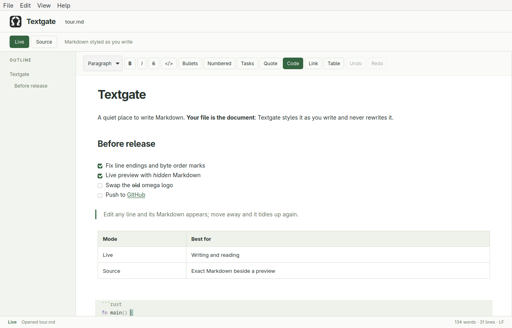
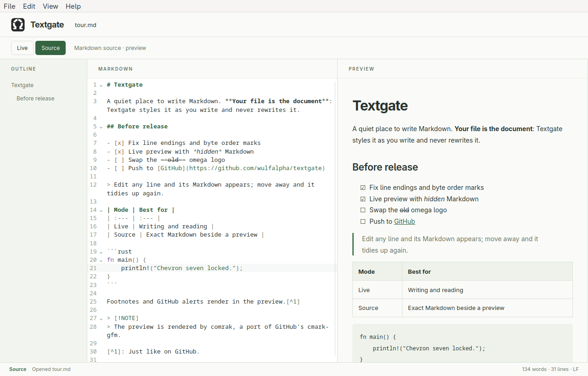

# Textgate

A lightweight desktop Markdown editor built with Rust, Tauri 2, CodeMirror 6, and comrak.

**Status: early prototype.** Native cross-platform release validation is still
pending. See the [release checklist](docs/release-checklist.md) and
[contributor guide](CONTRIBUTING.md).



The [Textgate logo](docs/branding/README.md) combines a segmented omega
with code-bracket feet, with a vector master and desktop icon exports.

**Your Markdown file is the document.** Textgate never re-serializes it: the only
changes saved are the ones you type or the formatting commands you run, and those
touch only the markup they add or remove. Line endings (LF, CRLF or CR) and a
UTF-8 byte order mark are preserved on save. Files that are not valid UTF-8 are
refused rather than opened lossily. The app uses vanilla JavaScript and CSS with
Vite; no UI framework is required.

## Live and Source modes

Both modes are the same editor with one undo history, so switching never changes
the text, and Vim bindings work in both.

- **Live** (default) styles Markdown in place: headings, emphasis, links, quotes,
  lists, code, and rules render as formatted text, and their markup is hidden
  except on the lines you are editing. Task checkboxes are clickable (toggling
  only the `x`). Tables render as tables; click one, or move the cursor into it,
  to edit its Markdown. HTML, front matter, and link definitions are shown as
  source.
- **Source** shows plain Markdown beside a rendered preview.



The toolbar (Live mode) sets headings, toggles bold, italic, strikethrough, inline
code, lists, task lists, quotes, and code blocks, inserts tables, and adds, edits,
or removes links. Ctrl/Cmd+B and Ctrl/Cmd+I work in both modes. Enter continues
lists and quotes.

The preview is rendered in Rust by [comrak](https://github.com/kivikakk/comrak),
a port of GitHub's cmark-gfm, with tables, task lists, strikethrough, autolinks,
footnotes, GitHub alerts (`> [!NOTE]`), and heading anchors; YAML front matter is
not rendered. Output is sanitized with DOMPurify. Browser-only `npm run dev` has no
Rust backend and falls back to `marked`, which can differ in edge cases.

## CSS themes

Open **View → Themes…** and use the **Theme** picker. Textgate creates editable `light.css`
and `dark.css` files on first use, preserving existing files. **Default** always
restores the built-in light appearance, even if you have edited `light.css`.

Theme files live in:

- Linux: `$XDG_CONFIG_HOME/textgate/themes/`, or `~/.config/textgate/themes/`
  when XDG_CONFIG_HOME is unset/empty (relative XDG paths are ignored).
- macOS: `~/Library/Application Support/textgate/themes/`.
- Windows: `%APPDATA%\textgate\themes\`.

The Themes dialog shows the exact directory used by your installation. Copy a starter
theme to `my-theme.css`, edit it, then press **Reload** to refresh the picker and
apply changes. Reload is manual; no restart is needed. The selected filename is
saved in `textgate/theme.txt` beside the themes directory and restored at startup.
Theme files must be UTF-8, regular `.css` files, at most 1 MiB (no symlinks).

Themes are ordinary CSS appended after the app stylesheet. You can override any
selector, but the `--tg-*` custom properties are the easiest way to cover the app,
live editor, source editor, and preview consistently. For example:

```css
:root {
  --tg-accent: #7651b5;
  --tg-on-accent: white;
  --tg-font-document: Georgia, serif;
}
```

Copy `dark.css` for a complete dark palette, including `color-scheme: dark` for
native form controls. The starter files list all color/font properties. Syntax
colors use `--tg-syntax-keyword`, `--tg-syntax-string`, and `--tg-syntax-number`;
source token classes such as `.tok-heading` can also be styled directly.

Choose **Default** or press **Ctrl/Cmd+Alt+0** to reset, even if custom CSS hides
the controls. Unreadable/missing saved themes fall back to Default with a status
message. Invalid CSS declarations are ignored by the webview. Themes should be
self-contained: relative config-directory assets/imports are not resolved and the
app's existing content security policy still restricts external resources.
Browser-only `npm run dev` uses Default; config-file themes require the desktop app.

## Run

Install a current Rust toolchain, Node.js 22.12+ (or 24+), and the
[Tauri platform prerequisites](https://v2.tauri.app/start/prerequisites/).
On Linux these include GTK 3 and WebKitGTK 4.1 development packages.

```sh
npm ci
npm run tauri dev
```

The Rust crate and Tauri configuration live at the repository root. `npm run dev`
runs only the browser UI; native file operations require the desktop app.

```sh
npm test
npm run build
cargo fmt --check
cargo test --locked
cargo clippy --locked --all-targets -- -D warnings
npm run tauri build
```

The last command builds the executable in `target/release/` and installers in
`target/release/bundle/`: `.deb` and `.rpm` on Linux, `.app` and `.dmg` on macOS,
and NSIS and MSI installers on Windows. Builds are unsigned.

AppImages are built only by the release workflow, on Ubuntu 22.04: an AppImage
runs only on systems whose glibc is at least as new as the build machine's.
Pushing a `v*` tag builds every platform and attaches the packages to a draft
GitHub Release.

## Keyboard shortcuts

The desktop app has native **File**, **Edit**, **View**, and **Help** menus.
On macOS, About and Quit appear in the application menu. Browser-only development
uses an in-page menu bar. The Live/Source switch and formatting toolbar
remain visible; View controls the outline, preview pane, Vim bindings, and themes.

| Action | Shortcut |
| --- | --- |
| New | Ctrl/Cmd+N |
| Open | Ctrl/Cmd+O |
| Save | Ctrl/Cmd+S |
| Save as | Ctrl/Cmd+Shift+S |
| Quit | Ctrl/Cmd+Q |

Choose **View → Vim bindings** to enable Vim editing in either mode. The status
bar shows the current Vim mode. Standard CodeMirror editing,
undo, search, and selection shortcuts are available otherwise.
Fenced code blocks use their language label (such as `python`, `py`, or `rust`)
for syntax highlighting; language parsers load on demand from bundled assets.
Unknown or unlabeled fences remain plain code. Tab indents and
Shift+Tab unindents the current line or selected lines. To move keyboard focus
out of the editor, press Escape followed by Tab.

## Scope and next steps

Next milestones:

- Table row/column commands for Live mode.
- Atomic saves (write to a temporary file, then rename).
- Folder explorer and sidebar tabs.
- Local image resolution and external link opening (preview links currently show
  their destination in the status bar; remote images are blocked in the desktop app).
- Cross-platform packaging and validation (a Linux CI workflow is included).

Only a single document is open at a time. New/open/close ask before discarding
unsaved changes. There is no crash recovery or autosave yet. File permissions are
restricted to paths granted through the native file dialogs, plus the dedicated
Textgate theme configuration handled by the Rust backend.

## License

Textgate is licensed under the [MIT License](LICENSE).
