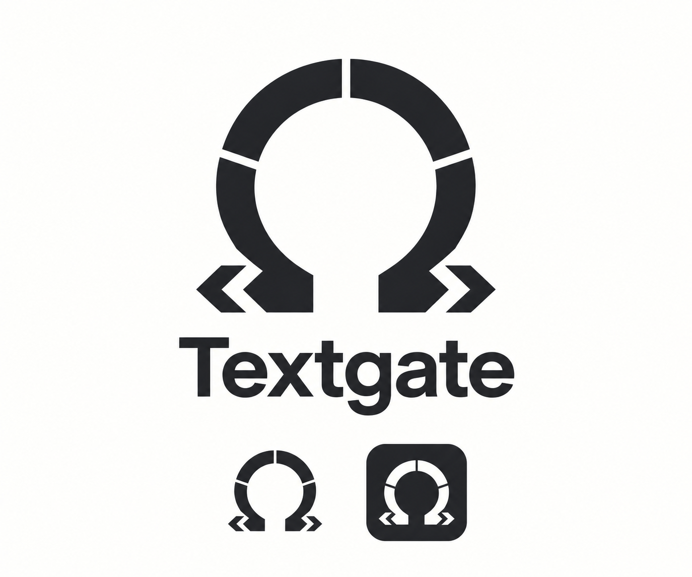

# Textgate logo direction

The mark is an omega gateway: a circular omega whose ring is divided by three
V-notch chevron cuts pointing at its centre, standing between a `<` and a `>`
code bracket. The gateway theme is inspired by science-fiction portals, with
distinct Textgate geometry. Keep it that way: no glyph rings, chevron lights,
or other franchise imagery.

The PNG above is the original concept presentation, generated with the built-in
image generation tool and selected on 2026-10-27. Its geometry was reconstructed
as an SVG master, then refined on 2026-10-27: the legs end straight, the doubled
feet became single code brackets, and the thin radial cuts became V-notch chevrons.

## Masters

- [`icons/source.svg`](../../icons/source.svg): the full mark, for 48 px and up
  (About dialog, dock, large app icons).
- [`icons/source-small.svg`](../../icons/source-small.svg): a simplified mark for
  16–32 px (taskbar, favicon, header). It has a thicker ring, wide straight cuts,
  and plain omega feet instead of brackets, because the chevrons and brackets
  blur together at those sizes.

## Regenerating icons

Run `npm run icons`. It renders both masters with `tauri icon` and writes the
desktop PNG, ICO, and ICNS files to `icons/`, taking the 16–32 px layers of
`icon.ico` and `icon.icns` (and `32x32.png`) from the small mark. Native icon paths
are in `tauri.conf.json`; the web UI uses the SVGs directly.
